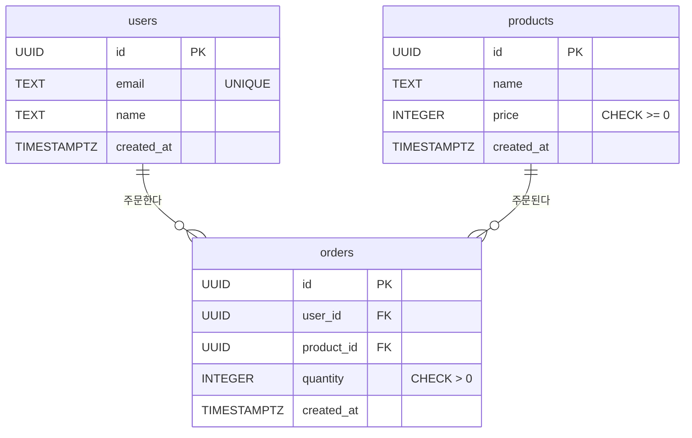
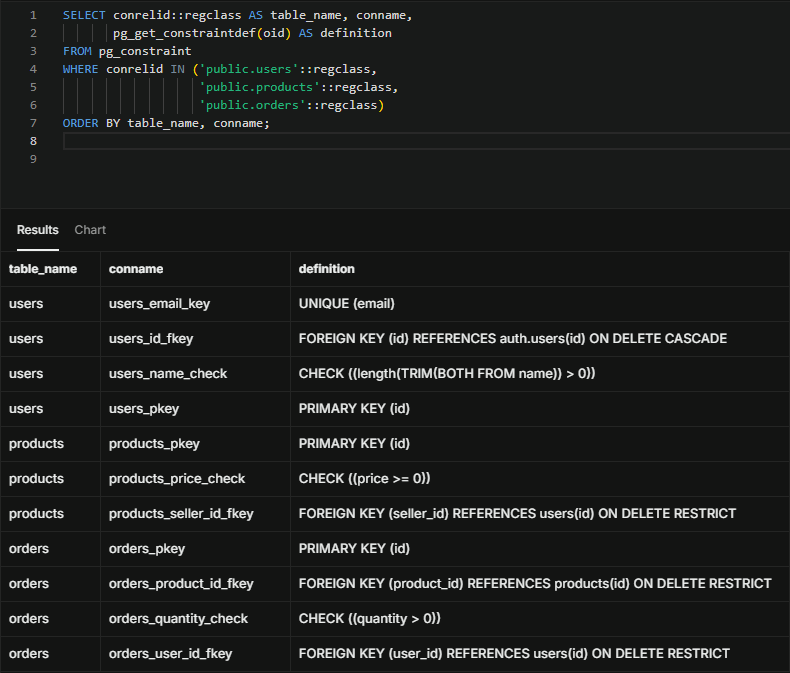
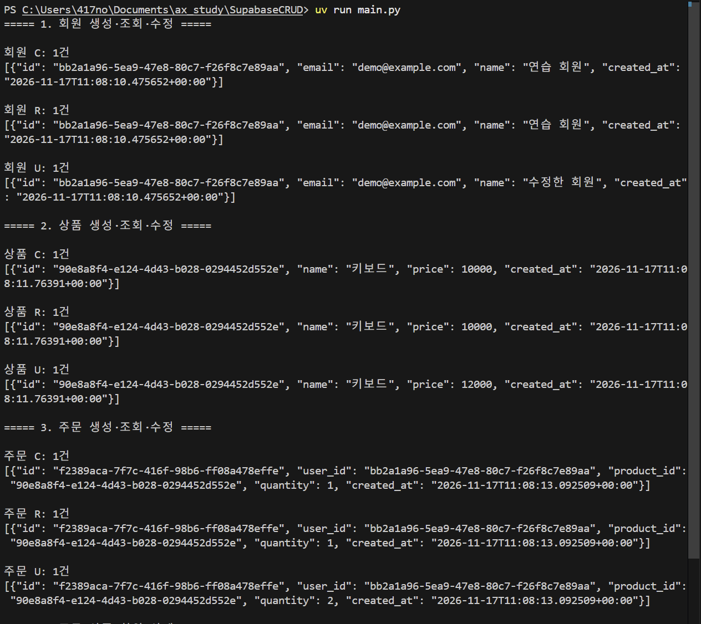
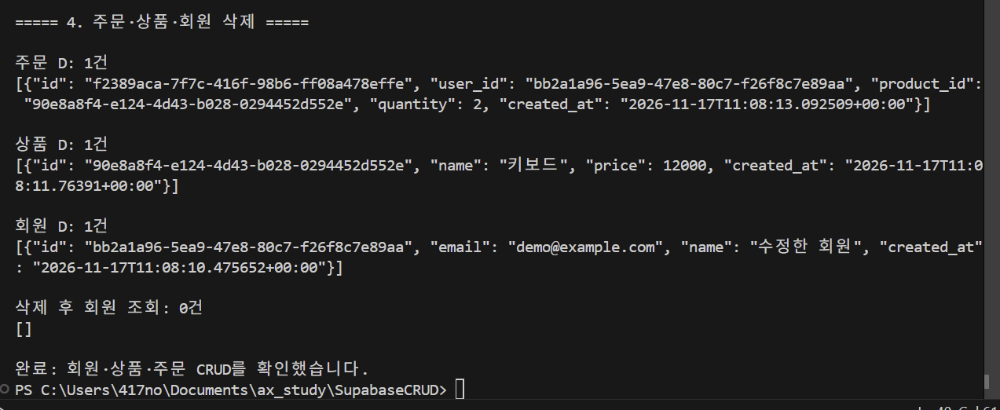

# Supabase 쇼핑몰 CRUD

회원·상품·주문 3개 테이블을 Supabase(PostgreSQL)에 만들고, Supabase Python SDK로 각 테이블의 생성(Create)·조회(Read)·수정(Update)·삭제(Delete)를 실행합니다.

## 1. 기술 스택

- Python 3.13 / uv (패키지·가상환경 관리)
- Supabase (PostgreSQL)
- `supabase` Python SDK, `python-dotenv`

## 2. 파일 구성

| 파일 | 설명 |
|---|---|
| `pyproject.toml`, `uv.lock`, `.python-version` | uv 프로젝트 설정, 의존성, Python 버전 |
| `schema.sql` | 회원·상품·주문 테이블 생성 SQL (PK, FK, 제약조건) |
| `main.py` | Supabase SDK로 3개 테이블 CRUD 함수 12개와 실행 시나리오 |
| `.env.example` | Supabase 연결 정보 양식 (실제 `.env`는 Git에서 제외) |
| `docs/screenshots/` | 실행 화면 캡처 |

## 3. 실행 방법

### 3-1. uv 환경 구성

이 프로젝트는 아래 명령으로 만들었습니다.

```powershell
uv init
uv add supabase python-dotenv
```

저장소를 받아서 실행할 때는 아래처럼 하면 됩니다.

```powershell
uv sync
```

`uv sync`가 `.venv` 가상환경을 만들고 `uv.lock`에 적힌 버전 그대로 라이브러리를 설치합니다.

### 3-2. Supabase 설정

1. Supabase에서 새 프로젝트를 만듭니다.
2. SQL Editor에서 `schema.sql` 전체를 실행합니다.
3. `.env.example`을 복사해 `.env`를 만들고 값을 입력합니다.

```powershell
Copy-Item .env.example .env
```

```dotenv
SUPABASE_URL=https://<project-id>.supabase.co
SUPABASE_PUBLISHABLE_KEY=<Project Settings → API Keys의 Publishable key>
```

### 3-3. 실행

```powershell
uv run main.py
```

## 4. 테이블 상세

명명 규칙: 테이블 이름은 소문자 복수형(`users`, `products`, `orders`), FK 컬럼은 `참조테이블_id` 형식입니다.

### 회원 `users`

| 컬럼 | 타입 | 제약조건 |
|---|---|---|
| id | UUID | **PK**, DEFAULT `gen_random_uuid()` |
| email | TEXT | NOT NULL, UNIQUE |
| name | TEXT | NOT NULL, CHECK `length(trim(name)) > 0` (ALTER TABLE로 추가) |
| created_at | TIMESTAMPTZ | NOT NULL, DEFAULT `now()` |

### 상품 `products`

| 컬럼 | 타입 | 제약조건 |
|---|---|---|
| id | UUID | **PK**, DEFAULT `gen_random_uuid()` |
| name | TEXT | NOT NULL |
| price | INTEGER | NOT NULL, CHECK `price >= 0` |
| created_at | TIMESTAMPTZ | NOT NULL, DEFAULT `now()` |

### 주문 `orders`

| 컬럼 | 타입 | 제약조건 |
|---|---|---|
| id | UUID | **PK**, DEFAULT `gen_random_uuid()` |
| user_id | UUID | NOT NULL, **FK → users(id)**, ON DELETE RESTRICT |
| product_id | UUID | NOT NULL, **FK → products(id)**, ON DELETE RESTRICT |
| quantity | INTEGER | NOT NULL, CHECK `quantity > 0` |
| created_at | TIMESTAMPTZ | NOT NULL, DEFAULT `now()` |

### 테이블 관계



- 회원 1명 : 주문 N건, 상품 1개 : 주문 N건
- 주문에는 회원 이름이나 상품 이름을 복사하지 않고 FK(`user_id`, `product_id`)로만 연결합니다.
- `ON DELETE RESTRICT` 때문에 주문이 남아 있는 회원·상품은 삭제할 수 없습니다. 그래서 삭제는 **주문 → 상품 → 회원** 순서로 합니다.

### PK·FK 확인

Supabase SQL Editor에서 아래 쿼리로 제약조건을 확인했습니다.

```sql
SELECT conrelid::regclass AS table_name, conname,
       pg_get_constraintdef(oid) AS definition
FROM pg_constraint
WHERE conrelid IN ('public.users'::regclass,
                   'public.products'::regclass,
                   'public.orders'::regclass)
ORDER BY table_name, conname;
```



## 5. CRUD 구현

`main.py`에서 `supabase.table("테이블명")` 뒤에 `insert / select / update / delete`와 `.execute()`를 붙여 요청합니다.

| 테이블 | Create | Read | Update | Delete |
|---|---|---|---|---|
| users | `create_user(email, name)` | `get_user(user_id)` | `update_user(user_id, name)` | `delete_user(user_id)` |
| products | `create_product(name, price)` | `get_product(product_id)` | `update_product(product_id, price)` | `delete_product(product_id)` |
| orders | `create_order(user_id, product_id, quantity)` | `get_order(order_id)` | `update_order(order_id, quantity)` | `delete_order(order_id)` |

실행 순서 (`run_demo()`):

1. 회원 생성 → 조회 → 이름 수정
2. 상품 생성(10,000원) → 조회 → 가격 수정(12,000원)
3. 주문 생성(수량 1) → 조회 → 수량 수정(2)
4. 주문 → 상품 → 회원 순서로 삭제 → 삭제한 회원을 다시 조회해 0건 확인

## 6. 실행 결과

### 회원·상품·주문 생성, 조회, 수정



### 삭제와 삭제 후 조회



## 7. 참고

- 이 과제는 필수 구현 범위(uv 환경, 스키마, Supabase 연동, CRUD)만 다룹니다. 로그인 없이 SDK로 접근하도록 RLS를 끄고 `anon` 역할에 권한을 주었습니다. 실제 서비스에서는 RLS와 인증을 켜야 합니다.
- `.env`(Supabase 키)와 `.venv`는 `.gitignore`로 업로드에서 제외했습니다.
